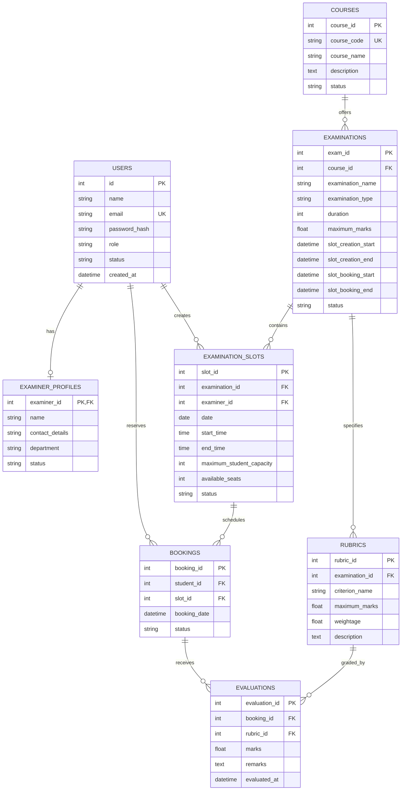

# Examination Management Portal (EMP)

An enterprise-grade, full-stack Academic Examination Management Portal developed for higher education institutions (such as IIT Madras). The platform streamlines viva voce sessions, practical lab evaluations, project demonstrations, and assessment grading through role-based access control, automated slot scheduling, capacity enforcement, and rubric-driven evaluations.

Built strictly with **Flask**, **Jinja2**, **HTML5/Bootstrap 5**, and **SQLite (SQLAlchemy)**, operating entirely on pure server-side architecture without any core JavaScript dependencies.

---

## Table of Contents

1. [Project Overview](#project-overview)
2. [Mandatory Technology Stack](#mandatory-technology-stack)
3. [User Roles & Permissions](#user-roles--permissions)
4. [Core Business Rules & Enforcements](#core-business-rules--enforcements)
5. [Database Architecture & ER Schema](#database-architecture--er-schema)
6. [Project Structure](#project-structure)
7. [Installation & Setup](#installation--setup)
8. [Database Initialization & Seeding](#database-initialization--seeding)
9. [How to Run the Application](#how-to-run-the-application)
10. [Demo User Credentials](#demo-user-credentials)
11. [REST API Documentation](#rest-api-documentation)
12. [Testing & Verification](#testing--verification)
13. [Key Code Sections Explained](#key-code-sections-explained)

---

## 1. Project Overview

The **Examination Management Portal (EMP)** is designed to eliminate manual scheduling conflicts and subjective grading in high-stakes academic evaluations. The platform coordinates three primary stakeholders:
- **Academic Administrators**: Define courses, configure examination timelines, set up evaluation rubrics, approve faculty examiner registrations, reschedule bookings, and monitor institution-wide exam workloads.
- **Faculty Examiners**: Register for institutional verification, schedule examination time slots within authorized timeline windows, access booked candidate rosters, and submit granular rubric-based scores and feedback.
- **Students**: Search and filter upcoming evaluations, reserve available examination time slots within open booking periods, cancel reservations before deadlines, and view detailed official performance scorecards.

---

## 2. Mandatory Technology Stack

- **Backend Framework**: Flask 3.x (Python)
- **Database & ORM**: SQLite 3 with Flask-SQLAlchemy / SQLAlchemy 2.x
- **Session & Auth**: Flask-Login, Werkzeug Security (PBKDF2 SHA-256 password hashing)
- **Frontend / Presentation**: Jinja2 templating, HTML5, CSS3, Bootstrap 5.3 (via CDN)
- **Core Architecture**: 100% pure server-side form processing (`POST`/`GET`), zero core JavaScript dependency.

---

## 3. User Roles & Permissions

| Role | Registration Policy | Initial Status | Capabilities |
| :--- | :--- | :--- | :--- |
| **Admin** | Pre-seeded / Auto-created on startup (No public registration) | `active` | Full control over courses, examinations, rubrics, examiner approvals, slot reassignment, booking rescheduling, and search. |
| **Examiner** | Self-registration via `/register/examiner` | `pending` | Must be approved by Admin before accessing dashboard. Can manage time slots and evaluate candidates booked *only* in their slots. |
| **Student** | Self-registration via `/register/student` | `active` | Can search examinations, reserve slots during open booking windows, cancel bookings, and inspect results. |

Role access is strictly guarded at the backend using `@login_required` and the `@role_required('admin')`, `@role_required('examiner')`, and `@role_required('student')` decorators.

---

## 4. Core Business Rules & Enforcements

1. **Rule 1 — Slot Creation Window**:
   - Examiners can create, edit, or delete slots only when:
     `current_time >= slot_creation_start AND current_time <= slot_creation_end`
   - Once student booking opens (`current_time >= slot_booking_start`), examiners cannot modify or delete the slot.
2. **Rule 2 — Student Booking Period**:
   - Students can reserve slots only when:
     `current_time >= slot_booking_start AND current_time <= slot_booking_end`
3. **Rule 3 & 4 — Slot Capacity & Auto Full State**:
   - A slot cannot be booked beyond `maximum_student_capacity`.
   - On each booking, `available_seats` decrements by 1.
   - When `available_seats == 0`, status automatically updates to `Full`.
4. **Rule 5 — Duplicate Booking Prevention**:
   - A student is strictly prohibited from having more than one active booking for the same examination.
5. **Rule 6 — Examiner Authorization**:
   - An examiner can only view and evaluate students booked into slots created by or assigned to that specific examiner (`slot.examiner_id == current_user.id`).
6. **Rule 7 — Admin Override**:
   - Administrators can reassign slots to different examiners and reschedule existing student bookings to alternative open slots.
7. **Rule 8 — Preserving Booking History**:
   - Booking cancellations do not delete records; they transition status to `Cancelled` and immediately restore the seat to the slot (`available_seats += 1`, transitioning `Full` back to `Available`).

---

## 5. Database Architecture & ER Schema

All tables and foreign key relationships are defined programmatically using Flask-SQLAlchemy in the `models/` directory:



---

## 6. Project Structure

```
Exam Project IITM/
├── app.py                      # Flask Application Factory & Server Startup
├── config.py                   # App Configuration (SQLite URI, Secret Keys)
├── requirements.txt            # Python Dependencies
├── seed.py                     # Demo Data Populator
├── test_app.py                 # Automated Unit & Integration Test Suite
│
├── models/                     # Programmatic Relational Models
│   ├── __init__.py             # Exports db and all models
│   ├── user.py                 # User & ExaminerProfile models
│   ├── course.py               # Course model
│   ├── examination.py          # Examination model & timeline helpers
│   ├── rubric.py               # Rubric criteria model
│   ├── slot.py                 # ExaminationSlot model & seat recalculation
│   ├── booking.py              # Student Booking model
│   └── evaluation.py           # Rubric-based Evaluation model
│
├── routes/                     # Blueprint Modular Route Controllers
│   ├── __init__.py             # Blueprints registration
│   ├── auth.py                 # Login, Registration & Session Logout
│   ├── admin.py                # Admin Dashboard, Courses, Exams, Slots, Reassignment
│   ├── examiner.py             # Examiner Dashboard, Slots, Student Roster, Evaluation
│   ├── student.py              # Student Dashboard, Exam Search, Booking, Results
│   └── api.py                  # Clean REST API endpoints
│
├── utils/                      # Utilities & Middleware
│   ├── __init__.py
│   └── decorators.py           # Role-based access control (@role_required)
│
├── templates/                  # Jinja2 HTML Templates (Pure Server-Side)
│   ├── base.html               # Master Layout (Navigation, Alerts, Footer)
│   ├── auth/                   # Authentication Views
│   │   ├── login.html
│   │   ├── register_examiner.html
│   │   ├── register_student.html
│   │   └── pending_approval.html
│   ├── admin/                  # Administrator Views
│   │   ├── dashboard.html
│   │   ├── courses.html
│   │   ├── course_form.html
│   │   ├── examinations.html
│   │   ├── examination_form.html
│   │   ├── examination_detail.html
│   │   ├── rubric_form.html
│   │   ├── examiners.html
│   │   ├── examiner_detail.html
│   │   ├── slots.html
│   │   ├── bookings.html
│   │   ├── reschedule_booking.html
│   │   └── search.html
│   ├── examiner/               # Examiner Faculty Views
│   │   ├── dashboard.html
│   │   ├── assigned_exams.html
│   │   ├── slots.html
│   │   ├── slot_form.html
│   │   ├── students.html
│   │   └── evaluate.html
│   └── student/                # Student Candidate Views
│       ├── dashboard.html
│       ├── examinations.html
│       ├── examination_detail.html
│       ├── my_bookings.html
│       ├── results.html
│       └── result_detail.html
│
├── static/                     # Static Assets
│   └── css/
│       └── style.css           # Custom Academic Design System
│
├── instance/
│   └── database.db             # Local SQLite Database File
│
└── README.md                   # Comprehensive Project Documentation
```

---

## 7. Installation & Setup

### Prerequisites
- Python 3.10+ (Verified on Python 3.13)
- Windows, macOS, or Linux

### Step 1: Create a Virtual Environment (Optional but Recommended)
```bash
python -m venv venv
```

Activate the virtual environment:
- **Windows (Command Prompt / PowerShell)**:
  ```powershell
  .\venv\Scripts\activate
  ```
- **macOS / Linux**:
  ```bash
  source venv/bin/activate
  ```

### Step 2: Install Required Dependencies
```bash
pip install -r requirements.txt
```

---

## 8. Database Initialization & Seeding

The application creates all SQLite database tables automatically upon startup if they do not exist. It also automatically generates the default administrator account.

To populate rich, realistic demo data (courses, active examinations with ongoing booking/slot creation windows, multiple examiners, students, bookings, and sample rubrics):

```bash
python seed.py
```

Output:
```
[EMP Seed] Clearing existing data...
[EMP Seed] Database populated successfully with demo records!
```

---

## 9. How to Run the Application

Launch the local Flask development server:
```bash
python app.py
```

The application will be running at:
```
http://127.0.0.1:5000/
```

Navigate to `http://127.0.0.1:5000/` in your browser. You will be automatically redirected to the login screen.

---

## 10. Demo User Credentials

The following pre-configured credentials are ready for demonstration:

| Role | Full Name | Email | Password | Status / Notes |
| :--- | :--- | :--- | :--- | :--- |
| **Admin** | System Administrator | `admin@emp.iitm.ac.in` | `Admin@123` | Full access, no registration |
| **Examiner** | Dr. Priya Sharma | `priya.sharma@emp.iitm.ac.in` | `Examiner@123` | Approved, CSE Department |
| **Examiner** | Prof. Rajesh Kumar | `rajesh.kumar@emp.iitm.ac.in` | `Examiner@123` | Approved, Software Eng. |
| **Examiner** | Dr. Ananya Sen | `ananya.sen@emp.iitm.ac.in` | `Examiner@123` | **Pending Approval** (tests admin approval flow) |
| **Student** | Rahul Verma | `rahul.verma@student.iitm.ac.in` | `Student@123` | Has active & completed bookings |
| **Student** | Sneha Patel | `sneha.patel@student.iitm.ac.in` | `Student@123` | Has completed exam & scores |
| **Student** | Amit Gupta | `amit.gupta@student.iitm.ac.in` | `Student@123` | Fresh student ready to book |

---

## 11. REST API Documentation

The application exposes clean, read-only JSON REST endpoints for external system interoperability:

| Method | Endpoint | Description |
| :--- | :--- | :--- |
| `GET` | `/api/examinations` | List all examinations with courses, durations, and timeline windows (supports `?status=...`). |
| `GET` | `/api/examinations/<id>` | Retrieve full details of an examination including rubrics and scheduled slots. |
| `GET` | `/api/slots` | List examination slots with capacity, availability, and examiners (supports `?exam_id=...&status=...`). |
| `GET` | `/api/bookings` | List all student bookings with statuses and evaluations. |
| `GET` | `/api/examiners` | List all faculty examiners and departmental profiles. |

---

## 12. Testing & Verification

A dedicated automated test suite is provided in `test_app.py`. It thoroughly tests authentication, role-based authorization, slot creation windows, student booking capacity limits, duplicate booking prevention, seat restoration upon cancellation, and rubric evaluation constraints.

Run the test suite:
```bash
python test_app.py
```

Expected Output:
```
Ran 7 tests in 3.839s
OK
```

---

## 13. Key Code Sections Explained

### 1. Programmatic Relational Models (`models/`)
All models leverage SQLAlchemy 2.0+ conventions:
- `Examination.is_slot_creation_period(now)`: Computes dynamically whether the current timestamp falls within the authorized window.
- `ExaminationSlot.recalculate_seats()`: Dynamically verifies active bookings and automatically switches status between `Available` and `Full`.

### 2. Role-Based Access Control (`utils/decorators.py`)
Custom Python decorator `@role_required(*roles)`:
- Verifies session authentication (`current_user.is_authenticated`).
- Checks user role membership.
- Intercepts unapproved examiners (`status == 'pending'`) and gracefully redirects them to `/pending-approval`.

### 3. Pure Server-Side Transaction Processing
- **Slot Reservation** (`routes/student.py`): Checks the student booking window, validates non-duplicate bookings for the course/exam, verifies `available_seats > 0`, decrements available capacity, and conditionally flips the slot to `Full` inside an atomic database transaction.
- **Seat Release on Cancellation**: Cancelling changes booking status to `Cancelled` (never deletes history) and triggers slot seat recalculation, restoring `Full` slots to `Available`.
- **Examiner Evaluation** (`routes/examiner.py`): Verifies that the evaluating examiner owns the booked slot, validates that submitted marks for each rubric criterion fall between `0` and `rubric.maximum_marks`, and stores evaluations and qualitative remarks in SQLite.
