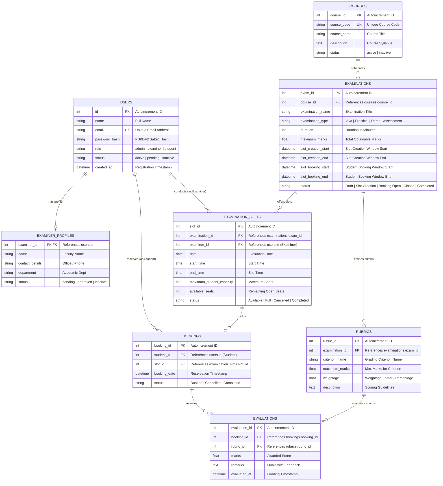

# Examination Management Portal (EMP)

An enterprise-grade, full-stack Academic Examination Management Portal developed for higher education institutions (such as IIT Madras). The platform streamlines viva voce sessions, practical lab evaluations, project demonstrations, and assessment grading through role-based access control, automated slot scheduling, capacity enforcement, and rubric-driven evaluations.

Built strictly with **Flask**, **Jinja2**, **HTML5/Bootstrap 5**, and **SQLite (SQLAlchemy)**, operating entirely on pure server-side architecture without any core JavaScript dependencies.

---

## Table of Contents

1. [Executive Summary & Problem Statement](#1-executive-summary--problem-statement)
2. [Mandatory Technology Stack & Architectural Decisions](#2-mandatory-technology-stack--architectural-decisions)
3. [User Roles & RBAC Matrix](#3-user-roles--rbac-matrix)
4. [The 8 Core Business Rules & Execution Logic](#4-the-8-core-business-rules--execution-logic)
5. [Database Design & Schema Specifications](#5-database-design--schema-specifications)
6. [Mermaid Entity-Relationship (ER) Diagram](#6-mermaid-entity-relationship-er-diagram)
7. [Project Directory Architecture](#7-project-directory-architecture)
8. [Installation & Local Setup Guide](#8-installation--local-setup-guide)
9. [Database Initialization & Seed Scenarios](#9-database-initialization--seed-scenarios)
10. [Local Server Execution](#10-local-server-execution)
11. [Demo Credentials Table](#11-demo-credentials-table)
12. [End-to-End Manual Testing Walkthrough](#12-end-to-end-manual-testing-walkthrough)
13. [REST API Documentation](#13-rest-api-documentation)
14. [Automated Test Suite (`test_app.py`)](#14-automated-test-suite-test_apppy)
15. [Security & Data Integrity Measures](#15-security--data-integrity-measures)
16. [Viva Voce & Project Defense Guide](#16-viva-voce--project-defense-guide)
17. [AI & LLM Usage Declaration](#17-ai--llm-usage-declaration)

---

## 1. Executive Summary & Problem Statement

### The Problem
In academic institutions offering degree programs with large student cohorts, managing individual oral examinations (Viva Voce), practical laboratory demonstrations, and capstone project defenses presents severe operational challenges:
- **Scheduling Conflicts**: Overlapping student and faculty availability often leads to double-booking or underutilized examination blocks.
- **Subjectivity in Grading**: Without standardized, multi-criteria rubric evaluation, grading across disparate examiners lacks consistency.
- **Faculty Impersonation / Unauthorized Access**: Lack of strict approval gates allows unvetted accounts to alter academic marks or view sensitive student rosters.
- **Lost Audit History**: Premature deletion of cancelled slots and dropped reservations destroys institutional audit records.

### The Solution: EMP
The **Examination Management Portal (EMP)** automates the entire evaluation lifecycle through pure server-side deterministic workflows:
- **Role-Based Workflows**: Independent, strictly isolated portals for Administrators, Faculty Examiners, and Student Candidates.
- **Windowed Scheduling**: Configurable timeline windows governing when faculty may open slots and when candidates may book them.
- **Strict Capacity Controls**: Atomic increment/decrement of slot capacity with automated `Full` status transitions.
- **Multi-Parameter Rubric Scoring**: Standardized criterion-by-criterion scoring with maximum limits and qualitative remarks.
- **Complete Booking Preservation**: Cancelled reservations release seats while retaining historical records for auditing.

---

## 2. Mandatory Technology Stack & Architectural Decisions

| Layer | Technology | Rationale / Architectural Decision |
| :--- | :--- | :--- |
| **Backend Framework** | **Flask 3.x (Python)** | Lightweight, deterministic, highly modular via Blueprints (`routes/`). Complies with requirement to avoid bulky microservice frameworks. |
| **Database & ORM** | **SQLite 3 + SQLAlchemy 2.x / Flask-SQLAlchemy** | Zero-configuration relational database stored locally in `instance/database.db`. Tables created programmatically via ORM models with foreign key integrity. |
| **Authentication** | **Flask-Login + Werkzeug Security** | Secure session cookie management; passwords hashed with PBKDF2 with SHA-256 salt. Zero plain-text password storage. |
| **Frontend Templates** | **Jinja2 + HTML5** | Server-side rendering (SSR). Dynamic data binding, custom filters for dates (`date_format`), times (`time_format`), and datetimes (`datetime_format`). |
| **Styling & Presentation** | **Bootstrap 5.3 + Custom CSS** | Professional academic interface with curated color tokens, responsive cards, data tables, and badges. |
| **Core Interaction** | **Pure Server-Side (`GET` / `POST` Forms)** | **Zero core JavaScript dependency**. Every button, filter, registration, reservation, and evaluation functions via standard HTTP form submission. |

### Prohibited Technologies Adhered To:
- ❌ No React, Angular, or Vue
- ❌ No Node.js / Express
- ❌ No MongoDB, MySQL, or PostgreSQL
- ❌ No Tailwind CSS or ad-hoc CSS frameworks
- ❌ No client-side JavaScript handling of business logic or booking workflows

---

## 3. User Roles & RBAC Matrix

```
                      +-------------------+
                      |   Portal Entry    |
                      +---------+---------+
                                |
                 +--------------+---------------+
                 |                              |
         [Existing Admin]                [Registration]
                 |                              |
                 v                      +-------+-------+
          +--------------+              |               |
          | Admin Login  |        [Examiner Reg]  [Student Reg]
          +------+-------+              |               |
                 |                      v               v
                 |               Status: PENDING  Status: ACTIVE
                 |                      |               |
                 |               Admin Approves?        v
                 |               (No -> Blocked)  [Student Portal]
                 |               (Yes -> Active)
                 |                      |
                 |                      v
                 v              [Examiner Portal]
          [Admin Portal]
```

### Detailed Role Permissions Matrix

| Feature / Action | Admin | Examiner (Approved) | Examiner (Pending) | Student |
| :--- | :---: | :---: | :---: | :---: |
| **Self-Registration** | ❌ (Pre-seeded only) | ❌ | ✅ (`/register/examiner`) | ✅ (`/register/student`) |
| **Portal Access** | ✅ Full Access | ✅ Approved Access | ❌ (Redirected to `/pending-approval`) | ✅ Immediate Access |
| **Course CRUD** | ✅ Full CRUD | ❌ View Only | ❌ | ❌ View Only |
| **Examination Management** | ✅ Full CRUD & Timelines | ❌ View Assigned | ❌ | ❌ Browse Open |
| **Rubric Criteria Definition** | ✅ Full CRUD | ❌ View Rubrics | ❌ | ❌ View Rubrics |
| **Examiner Approvals** | ✅ Approve / Deactivate | ❌ | ❌ | ❌ |
| **Slot Creation & Scheduling** | ✅ View / Reassign | ✅ Create/Edit (in window) | ❌ | ❌ |
| **Slot Booking / Reservation** | ✅ View / Override | ❌ | ❌ | ✅ Book (in window) |
| **Booking Cancellation** | ✅ Admin Cancel | ❌ | ❌ | ✅ Cancel (before deadline) |
| **Booking Rescheduling** | ✅ Admin Reschedule | ❌ | ❌ | ❌ |
| **Candidate Evaluation** | ❌ | ✅ Evaluate (Own slots only) | ❌ | ❌ |
| **Scorecard Viewing** | ✅ View All | ✅ View Own Candidates | ❌ | ✅ View Own Scorecard |

---

## 4. The 8 Core Business Rules & Execution Logic

### Rule 1 — Examiner Slot Creation Window
- **Rule**: Examiners can create, edit, or delete time slots **only** during the examination's slot creation window:
  $$\text{slot\_creation\_start} \le \text{current\_time} \le \text{slot\_creation\_end}$$
- **Lockout Mechanism**: Once student booking starts ($\text{current\_time} \ge \text{slot\_booking\_start}$), slots are permanently locked from modification or deletion by the examiner to protect already reserved candidate schedules.
- **Code Reference**: Enforced in `routes/examiner.py` (`new_slot`, `edit_slot`, `delete_slot`).

### Rule 2 — Student Booking Window
- **Rule**: Students can reserve slots **only** during the examination's active booking period:
  $$\text{slot\_booking\_start} \le \text{current\_time} \le \text{slot\_booking\_end}$$
- **Code Reference**: Enforced in `routes/student.py` (`book_slot`).

### Rule 3 — Strict Capacity Enforcement
- **Rule**: A slot can never accept reservations beyond its `maximum_student_capacity`.
- On every confirmed booking, `available_seats` decrements by 1:
  $$\text{available\_seats}_{\text{new}} = \text{available\_seats}_{\text{old}} - 1$$
- **Code Reference**: Enforced in `routes/student.py` (`book_slot`).

### Rule 4 — Automatic Full Status Transition
- **Rule**: When `available_seats == 0`, the slot's status automatically switches to `'Full'`. Full slots cannot be booked by any subsequent candidate.
- **Code Reference**: Enforced in `models/slot.py` (`recalculate_seats()`).

### Rule 5 — Duplicate Booking Prevention
- **Rule**: A student is strictly prohibited from holding multiple active reservations for the same examination.
- Before confirming a booking, the backend queries:
  $$\text{Booking.student\_id} == \text{current\_user.id} \quad \text{AND} \quad \text{Booking.status} == \text{'Booked'} \quad \text{AND} \quad \text{Slot.examination\_id} == \text{exam.exam\_id}$$
- If a record exists, the reservation is rejected with an explanatory alert.
- **Code Reference**: Enforced in `routes/student.py` (`book_slot`).

### Rule 6 — Examiner Authorization Isolation
- **Rule**: A faculty examiner can view, manage, and evaluate **only** candidates booked into time slots created by or assigned to that specific examiner:
  $$\text{slot.examiner\_id} == \text{current\_user.id}$$
- Accessing or evaluating another faculty member's candidate raises an authorization exception (`403 Forbidden` / flash error).
- **Code Reference**: Enforced in `routes/examiner.py` (`students`, `evaluate_student`).

### Rule 7 — Administrative Override
- **Rule**: System Administrators possess full override authority to:
  1. Reassign any slot to a different approved faculty examiner (`reassign_slot`).
  2. Reschedule a student's active booking to an alternative open slot belonging to the same examination (`reschedule_booking`).
  3. Update examination or slot statuses manually.
- **Code Reference**: Enforced in `routes/admin.py` (`reassign_slot`, `reschedule_booking`).

### Rule 8 — Preservation of Booking History
- **Rule**: Booking cancellations **never delete** database records.
- Cancelling updates the status to `'Cancelled'`.
- The reserved seat is released back to the slot ($\text{available\_seats} += 1$), restoring `'Full'` slots back to `'Available'`.
- The full audit trail of who booked and cancelled is preserved.
- **Code Reference**: Enforced in `routes/student.py` (`cancel_booking`) and `routes/admin.py` (`cancel_booking`).

---

## 5. Database Design & Schema Specifications

### 1. `users` Table
Stores authentication credentials and high-level role/status flags.
| Column | Type | Constraints | Description |
| :--- | :--- | :--- | :--- |
| `id` | `INTEGER` | `PRIMARY KEY AUTOINCREMENT` | Unique user ID |
| `name` | `VARCHAR(150)` | `NOT NULL` | Full legal name / title |
| `email` | `VARCHAR(150)` | `UNIQUE, NOT NULL, INDEX` | Login identifier |
| `password_hash` | `VARCHAR(256)` | `NOT NULL` | PBKDF2 SHA-256 salted hash |
| `role` | `VARCHAR(20)` | `NOT NULL` | `'admin'`, `'examiner'`, `'student'` |
| `status` | `VARCHAR(20)` | `NOT NULL, DEFAULT 'active'` | `'active'`, `'pending'`, `'inactive'` |
| `created_at` | `DATETIME` | `NOT NULL, DEFAULT CURRENT_TIMESTAMP` | Account creation timestamp |

### 2. `examiner_profiles` Table
Stores extended academic profile data for examiners.
| Column | Type | Constraints | Description |
| :--- | :--- | :--- | :--- |
| `examiner_id` | `INTEGER` | `PRIMARY KEY, FK -> users.id` | One-to-One link with `users` |
| `name` | `VARCHAR(150)` | `NOT NULL` | Faculty name with title |
| `contact_details` | `VARCHAR(150)` | `NULLABLE` | Office / Phone / Extension |
| `department` | `VARCHAR(150)` | `NULLABLE` | Academic department |
| `status` | `VARCHAR(20)` | `NOT NULL, DEFAULT 'pending'` | `'pending'`, `'approved'`, `'rejected'` |

### 3. `courses` Table
Stores departmental academic courses.
| Column | Type | Constraints | Description |
| :--- | :--- | :--- | :--- |
| `course_id` | `INTEGER` | `PRIMARY KEY AUTOINCREMENT` | Unique course ID |
| `course_code` | `VARCHAR(50)` | `UNIQUE, NOT NULL, INDEX` | e.g. `'CS101'`, `'CS202'` |
| `course_name` | `VARCHAR(200)` | `NOT NULL` | Official course title |
| `description` | `TEXT` | `NULLABLE` | Course syllabus & outcomes |
| `status` | `VARCHAR(20)` | `NOT NULL, DEFAULT 'active'` | `'active'`, `'inactive'` |

### 4. `examinations` Table
Defines examination sessions, parameters, and time windows.
| Column | Type | Constraints | Description |
| :--- | :--- | :--- | :--- |
| `exam_id` | `INTEGER` | `PRIMARY KEY AUTOINCREMENT` | Unique examination ID |
| `course_id` | `INTEGER` | `NOT NULL, FK -> courses.course_id` | Linked course |
| `examination_name`| `VARCHAR(200)` | `NOT NULL` | e.g. `'CS101 Viva Voce'` |
| `examination_type`| `VARCHAR(50)` | `NOT NULL` | `'Viva'`, `'Practical'`, `'Project Demo'`, `'Assessment'` |
| `duration` | `INTEGER` | `NOT NULL, DEFAULT 30` | Candidate duration in minutes |
| `maximum_marks` | `FLOAT` | `NOT NULL, DEFAULT 100.0` | Maximum obtainable score |
| `slot_creation_start`| `DATETIME` | `NOT NULL` | Window open for examiner scheduling |
| `slot_creation_end` | `DATETIME` | `NOT NULL` | Window close for examiner scheduling |
| `slot_booking_start` | `DATETIME` | `NOT NULL` | Window open for student booking |
| `slot_booking_end` | `DATETIME` | `NOT NULL` | Window close for student booking |
| `status` | `VARCHAR(30)` | `NOT NULL, DEFAULT 'Draft'` | `'Draft'`, `'Slot Creation'`, `'Booking Open'`, `'Closed'`, `'Completed'` |

### 5. `rubrics` Table
Defines granular criteria for evaluation.
| Column | Type | Constraints | Description |
| :--- | :--- | :--- | :--- |
| `rubric_id` | `INTEGER` | `PRIMARY KEY AUTOINCREMENT` | Unique rubric criterion ID |
| `examination_id`| `INTEGER` | `NOT NULL, FK -> examinations.exam_id` | Linked examination |
| `criterion_name`| `VARCHAR(200)`| `NOT NULL` | e.g. `'Algorithmic Problem Solving'` |
| `maximum_marks` | `FLOAT` | `NOT NULL` | Ceiling marks for this criterion |
| `weightage` | `FLOAT` | `NOT NULL, DEFAULT 100.0` | Weightage factor / percentage |
| `description` | `TEXT` | `NULLABLE` | Scoring benchmarks and guidelines |

### 6. `examination_slots` Table
Stores available time blocks scheduled by examiners.
| Column | Type | Constraints | Description |
| :--- | :--- | :--- | :--- |
| `slot_id` | `INTEGER` | `PRIMARY KEY AUTOINCREMENT` | Unique slot ID |
| `examination_id`| `INTEGER` | `NOT NULL, FK -> examinations.exam_id` | Linked examination |
| `examiner_id` | `INTEGER` | `NOT NULL, FK -> users.id` | Assigned faculty examiner |
| `date` | `DATE` | `NOT NULL` | Calendar date of evaluation |
| `start_time` | `TIME` | `NOT NULL` | Session start time |
| `end_time` | `TIME` | `NOT NULL` | Session end time |
| `maximum_student_capacity`| `INTEGER`| `NOT NULL, DEFAULT 1` | Total seats available |
| `available_seats`| `INTEGER` | `NOT NULL, DEFAULT 1` | Open seats remaining |
| `status` | `VARCHAR(30)` | `NOT NULL, DEFAULT 'Available'` | `'Available'`, `'Full'`, `'Cancelled'`, `'Completed'` |

### 7. `bookings` Table
Stores student reservations.
| Column | Type | Constraints | Description |
| :--- | :--- | :--- | :--- |
| `booking_id` | `INTEGER` | `PRIMARY KEY AUTOINCREMENT` | Unique booking ID |
| `student_id` | `INTEGER` | `NOT NULL, FK -> users.id` | Candidate student |
| `slot_id` | `INTEGER` | `NOT NULL, FK -> examination_slots.slot_id` | Reserved slot |
| `booking_date` | `DATETIME` | `NOT NULL, DEFAULT CURRENT_TIMESTAMP` | Reservation timestamp |
| `status` | `VARCHAR(30)` | `NOT NULL, DEFAULT 'Booked'` | `'Booked'`, `'Cancelled'`, `'Completed'` |

### 8. `evaluations` Table
Stores rubric-level marks and faculty feedback.
| Column | Type | Constraints | Description |
| :--- | :--- | :--- | :--- |
| `evaluation_id` | `INTEGER` | `PRIMARY KEY AUTOINCREMENT` | Unique evaluation entry ID |
| `booking_id` | `INTEGER` | `NOT NULL, FK -> bookings.booking_id` | Linked booking session |
| `rubric_id` | `INTEGER` | `NOT NULL, FK -> rubrics.rubric_id` | Criterion evaluated |
| `marks` | `FLOAT` | `NOT NULL, DEFAULT 0.0` | Marks awarded ($\le \text{rubric.max\_marks}$) |
| `remarks` | `TEXT` | `NULLABLE` | Qualitative critique / notes |
| `evaluated_at` | `DATETIME` | `NOT NULL, DEFAULT CURRENT_TIMESTAMP` | Evaluation timestamp |

---

## 6. Mermaid Entity-Relationship (ER) Diagram



---

## 7. Project Directory Architecture

```
Exam Project IITM/
├── app.py                      # Flask Application Factory, context filters & default admin auto-creation
├── config.py                   # Centralized configuration (SQLite URI, Secret Keys, debug flags)
├── requirements.txt            # Python dependencies (Flask, Flask-SQLAlchemy, Flask-Login, Werkzeug)
├── seed.py                     # Demo data populator with realistic academic courses and schedules
├── test_app.py                 # Automated unit and integration test suite (7 comprehensive test cases)
├── README.md                   # Full documentation with architecture, ER diagram, and testing guidelines
│
├── models/                     # Programmatic Relational Models (SQLAlchemy 2.0)
│   ├── __init__.py             # Initializes db = SQLAlchemy() and exports all models
│   ├── user.py                 # User (UserMixin) & ExaminerProfile models
│   ├── course.py               # Course model with cascade deletion
│   ├── examination.py          # Examination model with dynamic timeline period checkers
│   ├── rubric.py               # Rubric model for multi-criteria grading
│   ├── slot.py                 # ExaminationSlot model with dynamic seat recalculation
│   ├── booking.py              # Student Booking model with scoring properties
│   └── evaluation.py           # Rubric Evaluation model
│
├── routes/                     # Modular Flask Blueprints (Separation of Concerns)
│   ├── __init__.py             # Exports blueprints
│   ├── auth.py                 # Login, Student/Examiner registration, Pending notice, Logout
│   ├── admin.py                # Admin Dashboard, Courses, Exams, Rubrics, Examiners, Slots, Bookings, Search
│   ├── examiner.py             # Examiner Dashboard, Slot management, Candidate roster, Evaluation
│   ├── student.py              # Student Dashboard, Examination search, Slot booking, Cancellation, Scorecard
│   └── api.py                  # Read-only REST API endpoints (/api/examinations, /api/slots, etc.)
│
├── utils/                      # Decorators & Security Middleware
│   ├── __init__.py
│   └── decorators.py           # Role-based access control (@role_required) and approval verification
│
├── templates/                  # Pure Server-Side Jinja2 HTML Templates (100% Non-JS Core)
│   ├── base.html               # Master Layout (Navigation, Dismissible Alerts, Footer)
│   ├── auth/                   # Authentication Views
│   │   ├── login.html          # Login view with demo credentials quick reference
│   │   ├── register_examiner.html # Faculty registration form (sets status='pending')
│   │   ├── register_student.html  # Student candidate registration form (sets status='active')
│   │   └── pending_approval.html  # Notice page for unapproved faculty
│   ├── admin/                  # Administrative Management Views
│   │   ├── dashboard.html      # Institutional analytics & key metrics
│   │   ├── courses.html        # Course catalog with search & status filters
│   │   ├── course_form.html    # Course creation & update form
│   │   ├── examinations.html   # Examination catalog with timeline overview
│   │   ├── examination_form.html # Examination parameter & timeline window setup
│   │   ├── examination_detail.html # Rubric builder & scheduled slot overview
│   │   ├── rubric_form.html    # Multi-parameter grading criterion editor
│   │   ├── examiners.html      # Faculty directory with one-click approval buttons
│   │   ├── examiner_detail.html# Individual faculty profile & assigned workload
│   │   ├── slots.html          # Global slot management & examiner reassignment
│   │   ├── bookings.html       # Candidate reservation overview & history
│   │   ├── reschedule_booking.html # Admin override booking reschedule form
│   │   └── search.html         # Multi-table server-side search interface
│   ├── examiner/               # Faculty Examiner Views
│   │   ├── dashboard.html      # Workload metrics, pending evaluations counter
│   │   ├── assigned_exams.html # Available examinations open for slot creation
│   │   ├── slots.html          # Time slots created by the examiner (with edit/delete locks)
│   │   ├── slot_form.html      # Slot scheduling form (date, time, capacity)
│   │   ├── students.html       # Candidates booked strictly into examiner's slots
│   │   └── evaluate.html       # Rubric grading form with marks validation & remarks
│   └── student/                # Candidate Student Views
│       ├── dashboard.html      # Upcoming reservations & open examinations
│       ├── examinations.html   # Searchable catalog of open evaluations
│       ├── examination_detail.html # Slot selector & reservation trigger
│       ├── my_bookings.html    # Active & past bookings with seat-releasing cancellation
│       ├── results.html        # Completed examinations list
│       └── result_detail.html  # Official printable evaluation scorecard
│
├── static/                     # Static Styling Assets
│   └── css/
│       └── style.css           # Academic CSS theme, color tokens, and responsive table styling
│
└── instance/
    └── database.db             # Local SQLite database file
```

---

## 8. Installation & Local Setup Guide

### System Prerequisites
- **Python**: Version 3.10, 3.11, 3.12, or 3.13 (Verified on Python 3.13)
- **Git** (optional, for cloning)
- **OS**: Windows, macOS, or Linux

### Step 1: Open Terminal in Project Directory
```powershell
cd "c:\Users\ganes\OneDrive\Pictures\Documents\Desktop\Exam Project IITM"
```

### Step 2: Create a Python Virtual Environment
Creating an isolated virtual environment prevents library version conflicts:
- **Windows (PowerShell)**:
  ```powershell
  python -m venv venv
  .\venv\Scripts\Activate.ps1
  ```
- **Windows (Command Prompt `cmd`)**:
  ```cmd
  python -m venv venv
  .\venv\Scripts\activate.bat
  ```
- **macOS / Linux**:
  ```bash
  python3 -m venv venv
  source venv/bin/activate
  ```

### Step 3: Install Required Dependencies
Install the required packages from `requirements.txt`:
```bash
pip install -r requirements.txt
```

Verified dependencies in `requirements.txt`:
```text
Flask>=3.0.0
Flask-SQLAlchemy>=3.1.0
Flask-Login>=0.6.3
Werkzeug>=3.0.0
```

---

## 9. Database Initialization & Seed Scenarios

The system automatically initializes all database tables upon starting `app.py`. It also creates the default Administrator account if one does not exist.

To populate rich, realistic demo records covering all examination timeline states, run the dedicated seed script:

```bash
python seed.py
```

### What `seed.py` Pre-Populates:
1. **Admin Account**: `admin@emp.iitm.ac.in` / `Admin@123`
2. **Approved Examiners**: Dr. Priya Sharma (CSE) and Prof. Rajesh Kumar (Software Eng.)
3. **Pending Examiner**: Dr. Ananya Sen (Data Science) &mdash; use this to test the Admin approval workflow.
4. **Students**: Rahul Verma, Sneha Patel, Amit Gupta, Pooja Nair
5. **Four Courses**: CS101, CS202, CS303, CS404
6. **Active Timeline Scenarios**:
   - **CS101 (Booking Open)**: Slot creation closed, student booking is **active right now**.
   - **CS202 (Slot Creation Open)**: Slot creation is **active right now**, student booking starts next week.
   - **CS303 (Completed Exam)**: Pre-evaluated sessions with full rubric marks and feedback remarks ready for instant scorecard inspection.
   - **CS404 (Draft)**: Future examination.

---

## 10. Local Server Execution

Start the Flask application server:

```bash
python app.py
```

Server output:
```text
 * Serving Flask app 'app'
 * Debug mode: on
 * Running on http://127.0.0.1:5000
```

Open your web browser and navigate to:
👉 **`http://127.0.0.1:5000/`**

---

## 11. Demo Credentials Table

All accounts are pre-configured in `seed.py` for immediate demonstration:

| Role | Name | Email | Password | Pre-Configured State / Test Purpose |
| :--- | :--- | :--- | :--- | :--- |
| **Admin** | System Administrator | `admin@emp.iitm.ac.in` | `Admin@123` | Institutional superuser: course/exam CRUD, approvals, slot reassignment, rescheduling, global search. |
| **Examiner** | Dr. Priya Sharma | `priya.sharma@emp.iitm.ac.in` | `Examiner@123` | **Approved Faculty**: Has slots in CS101 and completed evaluations in CS303. |
| **Examiner** | Prof. Rajesh Kumar | `rajesh.kumar@emp.iitm.ac.in` | `Examiner@123` | **Approved Faculty**: Has scheduled slots in CS101. |
| **Examiner** | Dr. Ananya Sen | `ananya.sen@emp.iitm.ac.in` | `Examiner@123` | **Pending Approval**: Login triggers the "Under Review" notice. Approve via Admin to unlock dashboard. |
| **Student** | Rahul Verma | `rahul.verma@student.iitm.ac.in` | `Student@123` | **Active Student**: Holds active booking in CS101 and completed result in CS303. |
| **Student** | Sneha Patel | `sneha.patel@student.iitm.ac.in` | `Student@123` | **Active Student**: Holds completed result in CS303 with high percentage. |
| **Student** | Amit Gupta | `amit.gupta@student.iitm.ac.in` | `Student@123` | **Fresh Student**: Zero active bookings; ready to test booking in CS101. |

---

## 12. End-to-End Manual Testing Walkthrough

Follow this step-by-step test plan in your browser to verify all core project requirements:

### Test 1: Examiner Registration & Admin Approval Flow
1. Open [http://127.0.0.1:5000/register/examiner](http://127.0.0.1:5000/register/examiner).
2. Register a new faculty member (e.g., `dr.new@emp.iitm.ac.in` / `Pass@123`).
3. Attempt to log in with these credentials &rarr; Verify you are redirected to the **Account Pending Approval** screen (`/pending-approval`).
4. Log out and log in as Admin (`admin@emp.iitm.ac.in` / `Admin@123`).
5. Notice the warning banner on the dashboard indicating pending examiner registrations.
6. Click **Review Requests** or navigate to **Examiners** (`/admin/examiners`).
7. Click the green **Approve** button next to the new examiner.
8. Log out and log back in as the new examiner &rarr; Verify the **Examiner Dashboard** now opens cleanly!

### Test 2: Examiner Slot Scheduling (Rule 1 Enforcement)
1. Log in as approved examiner Dr. Priya Sharma (`priya.sharma@emp.iitm.ac.in` / `Examiner@123`).
2. Navigate to **Assigned Exams** (`/examiner/examinations`).
3. Notice that **CS202** is marked as `Slot Creation Open`.
4. Click **+ Add Slot** on CS202.
5. Set Date to tomorrow, Start Time to `10:00`, End Time to `10:30`, Capacity to `2`.
6. Submit the form &rarr; Verify slot appears under **My Slots** (`/examiner/slots`).
7. Verify that for **CS101** (where student booking has already started), the edit and delete buttons are disabled/locked, preventing modification after candidate bookings begin.

### Test 3: Student Slot Booking & Capacity Reduction (Rules 2, 3, 4, 5)
1. Log in as student Amit Gupta (`amit.gupta@student.iitm.ac.in` / `Student@123`).
2. Navigate to **Browse Exams** (`/student/examinations`).
3. Click on **CS101 Viva Voce Assessment** &rarr; Notice available slots with seat counters.
4. Click **Book Slot** on an available slot.
5. Confirm that you are redirected to **My Bookings** with the status `'Booked'`.
6. Navigate back to the exam detail page &rarr; Verify **Duplicate Booking Prevention (Rule 5)**: The page displays an alert saying you are already registered, and all other booking buttons are disabled.
7. Verify that on the slot booked, the remaining seat counter decremented by 1.

### Test 4: Booking Cancellation & Seat Restoration (Rules 6 & 8)
1. Still logged in as Amit Gupta, open **My Bookings** (`/student/bookings`).
2. Click **Cancel Booking** on your CS101 reservation.
3. Verify that the booking status changes to `'Cancelled'` (Rule 8: record is preserved, not deleted).
4. Return to **Browse Exams** &rarr; Verify the slot's seat counter incremented by 1, and the slot is open for booking again!

### Test 5: Examiner Candidate Evaluation & Scoring (Rule 6)
1. Log in as examiner Dr. Priya Sharma (`priya.sharma@emp.iitm.ac.in` / `Examiner@123`).
2. Navigate to **Booked Students** (`/examiner/students`).
3. Notice student Rahul Verma booked in your slot.
4. Click **Evaluate**.
5. Enter marks exceeding maximum marks (e.g. 50 when max is 30) &rarr; Verify backend validation rejects the submission with a clear error message.
6. Enter valid marks for all rubric criteria along with qualitative remarks and submit.
7. Verify candidate status updates to `'Completed'` and the calculated percentage score is displayed.

### Test 6: Official Student Scorecard Inspection
1. Log in as student Rahul Verma (`rahul.verma@student.iitm.ac.in` / `Student@123`).
2. Navigate to **My Results** (`/student/results`).
3. Click **View Scorecard** on **CS303 Final Project Demo**.
4. Verify the official institutional scorecard displays:
   - Student & Course details
   - Criterion-wise score breakdown against rubric maximums
   - Examiner qualitative remarks
   - Aggregate percentage and verified outcome banner.
5. Click **Print / Save Scorecard** to preview the clean, print-optimized scorecard layout.

### Test 7: Admin Rescheduling Override (Rule 7)
1. Log in as Admin (`admin@emp.iitm.ac.in` / `Admin@123`).
2. Open **Bookings** (`/admin/bookings`).
3. Click **Reschedule** on an active booking.
4. Select an alternative available slot and confirm.
5. Verify the booking is successfully transferred and both slots' available seats are properly recalculated.

---

## 13. REST API Documentation

The EMP platform provides clean, read-only REST API endpoints returning JSON data:

### 1. List All Examinations
- **Endpoint**: `GET /api/examinations`
- **Query Parameters**: `status` (optional, e.g. `?status=Booking%20Open`)
- **Sample Response**:
  ```json
  [
    {
      "exam_id": 1,
      "course_code": "CS101",
      "course_name": "Introduction to Programming & Problem Solving",
      "examination_name": "CS101 Viva Voce Assessment",
      "examination_type": "Viva",
      "duration": 30,
      "maximum_marks": 100.0,
      "slot_creation_start": "2026-09-28T17:45:00",
      "slot_creation_end": "2026-10-05T17:45:00",
      "slot_booking_start": "2026-10-01T17:45:00",
      "slot_booking_end": "2026-10-08T17:45:00",
      "status": "Booking Open",
      "rubrics_count": 3,
      "slots_count": 3
    }
  ]
  ```

### 2. Get Single Examination Details
- **Endpoint**: `GET /api/examinations/<exam_id>`
- **Sample Response**: Includes full rubric definitions and scheduled slots.

### 3. List Scheduled Slots
- **Endpoint**: `GET /api/slots`
- **Query Parameters**: `exam_id` (optional), `status` (optional)
- **Sample Response**:
  ```json
  [
    {
      "slot_id": 1,
      "examination_id": 1,
      "examination_name": "CS101 Viva Voce Assessment",
      "examiner_id": 2,
      "examiner_name": "Dr. Priya Sharma",
      "date": "2026-10-04",
      "start_time": "10:00",
      "end_time": "10:30",
      "capacity": 2,
      "available_seats": 1,
      "status": "Available"
    }
  ]
  ```

### 4. List Student Bookings
- **Endpoint**: `GET /api/bookings`
- **Sample Response**: Includes student names, dates, times, evaluation scores, and marks obtained.

### 5. List Faculty Examiners
- **Endpoint**: `GET /api/examiners`
- **Sample Response**: Lists all registered examiners, departments, contact details, and approval statuses.

---

## 14. Automated Test Suite (`test_app.py`)

A comprehensive automated test suite built with Python's standard `unittest` framework is located in `test_app.py`. It runs in-memory (`sqlite:///:memory:`) to ensure complete test isolation.

### Execute the Tests:
```bash
python test_app.py
```

### Test Cases Covered:
1. `test_default_admin_created`: Verifies automatic database creation and default Administrator credentials.
2. `test_examiner_registration_and_approval_workflow`: Verifies self-registration sets `pending` status, dashboard lockout while pending, Admin approval transition, and subsequent access.
3. `test_course_crud`: Tests course creation, duplicate code rejection, update, and status toggling.
4. `test_examination_and_rubrics_crud`: Tests examination creation with window validation and rubric addition.
5. `test_slot_creation_window_and_booking_rules`: Thoroughly verifies:
   - Decrementing capacity on booking.
   - Automatic `Full` status transition when available seats reach 0.
   - Rejection of duplicate bookings for the same examination.
   - Rejection of bookings on full slots.
   - Releasing seat and restoring `Available` status on cancellation.
   - Preservation of booking history.
6. `test_examiner_evaluation_and_result`: Verifies rubric score ceilings (rejecting scores $> \text{max\_marks}$), submission of evaluations, status update to `Completed`, and scorecard generation.
7. `test_rest_api_endpoints`: Verifies all JSON endpoints return HTTP 200 with valid structures.

Expected Output:
```text
Ran 7 tests in 2.509s
OK
```

---

## 15. Security & Data Integrity Measures

1. **Password Hashing**: Plaintext passwords are never stored. Werkzeug's `generate_password_hash` generates PBKDF2 hashes with unique salt per user.
2. **SQL Injection Mitigation**: All database operations utilize SQLAlchemy ORM parameterized queries; raw SQL concatenation is strictly avoided.
3. **Session Authentication**: Flask-Login securely stores user identifiers in encrypted, HTTP-only session cookies.
4. **Role-Based Authorization Guards**: Routes are defended by the `@role_required(*roles)` decorator. Unauthenticated or unauthorized access attempts are immediately rejected and redirected with flash notifications.
5. **Atomic Seat Transactions**: Seat counts and booking status changes occur within single database transactions (`db.session.commit()`), preventing race conditions and phantom seats.
6. **Data Cascade Protections**: Foreign keys with `ondelete='CASCADE'` ensure relational referential integrity when courses or examinations are deleted.

---

## 16. Viva Voce & Project Defense Guide

Common academic evaluation questions and their architectural answers:

### Q1: Why did you use pure server-side rendering instead of a JavaScript framework like React or Vue?
> **Answer**: Examination systems require strict deterministic workflows, high reliability, and universal accessibility across legacy institutional browsers. Using Flask with Jinja2 guarantees that business logic (booking windows, duplicate checks, seat decrements) is enforced strictly on the server without relying on client-side state that could be manipulated.

### Q2: How is concurrency and over-booking handled?
> **Answer**: Capacity is managed via integer counter tracking (`available_seats`) and checked within atomic database transactions. The `recalculate_seats()` method computes actual active bookings against `maximum_student_capacity`. If available seats reach 0, the slot status is immediately transitioned to `'Full'`.

### Q3: How do you enforce that examiners cannot grade students outside their slots?
> **Answer**: In `routes/examiner.py`, the `evaluate_student` route inspects the student's booking: `if booking.slot.examiner_id != current_user.id: abort(403)`. An examiner cannot view or evaluate candidates assigned to another faculty member.

### Q4: What happens when a student cancels an examination booking?
> **Answer**: Per Business Rule 8, the record is **not deleted**. Its status is updated to `'Cancelled'`. The slot's `recalculate_seats()` method is executed, which increments `available_seats` and restores a `'Full'` slot back to `'Available'`.

---

## 17. AI & LLM Usage Declaration

Per Requirements 21 & 22:
- **AI Coding Assistance**: Google Antigravity AI pair programming assistant was utilized during the development of this application for boilerplate generation, Bootstrap UI structuring, and automated test suite creation.
- **Architectural Understanding**: The complete architecture, relational schemas, role authorizations, business rule logic, and Flask controllers are fully transparent, commented, and comprehensible for oral academic defense.
